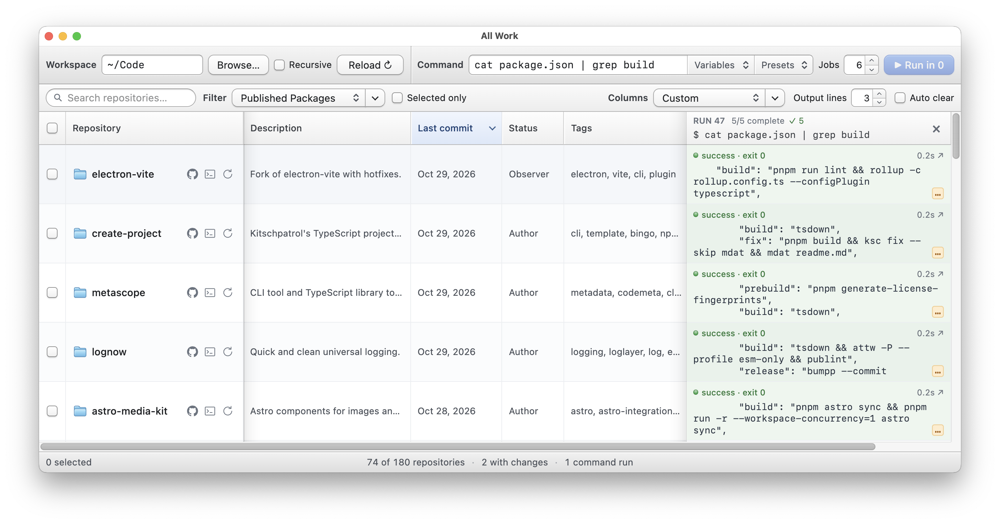

# All Work

<!-- badges({ githubRelease: true, custom: { Homebrew: { image: "https://img.shields.io/badge/Homebrew-kitschpatrol%2Ftap%2Fall--work-FBB040?logo=homebrew&logoColor=white", link: "https://github.com/kitschpatrol/homebrew-tap/blob/main/Casks/all-work.rb" } } }) -->

[](https://opensource.org/license/mit)
[](https://github.com/kitschpatrol/all-work/actions/workflows/ci.yml)
[](https://github.com/kitschpatrol/all-work/releases/latest)
[](https://github.com/kitschpatrol/homebrew-tap/blob/main/Casks/all-work.rb)

<!-- /badges -->

<!-- short-description -->

**Parallel command runner and data table to tame and tend your local Git projects.**

<!-- /short-description -->

<!-- banner({ src: './assets/screenshot.webp'}) -->



<!-- /banner -->

## Overview

All Work is a desktop application that simplifies managing and maintaining large collections of local Git repositories through an information-dense graphical interface.

It has two core competencies:

1. Aggregation and display of Git project metadata in a flexible, filterable data table, across <!-- column-count -->86<!-- /column-count --> extracted fields.
2. Quick execution of shell commands in parallel across all your projects, or on selected subsets matching specific criteria.

I developed All Work to help manage my 200+ local repositories, and am sharing it here in case anyone else might find it useful.

Please note that the project has some rough edges and the interface skews "developer". I'm only maintaining macOS builds for now.

_If you're just interested in access to the project metadata extraction and normalization tooling that powers the All Work data table, that's available in CLI and library form via [Metascope](https://github.com/kitschpatrol/metascope)._

## Getting started

### Installation

[Homebrew](https://brew.sh/) is the easiest way to install All Work:

```sh
brew install --cask kitschpatrol/tap/all-work
```

### First run

Find and launch **All Work.app** in your `/Applications` folder.

Click the **Browse…** button near the top left to select a folder containing one or more Git repositories.

The data table should then start to populate, with one repository per row. The first scan can take longer while metadata is extracted and the cache is built. Some remote metadata loads as its columns become visible or its rows are selected.

Select a few repositories using the checkbox in each row, enter `git status --short` in the **Command** field, and click the blue **Run** button. Each command runs in the selected repositories. Its output appears in a new column at the end of the table.

You might want to open **All Work → Preferences…** and enter your author names and GitHub account names under **Identity**. These identify your authored and maintained projects and power filter rules such as **is me** and **includes me**.

For additional GitHub metadata, All Work looks for `$GITHUB_TOKEN`, then `$GH_TOKEN`, in its process environment, then tries `gh auth token` through your login shell. The easiest setup when launching from Finder is to install the [GitHub CLI](https://cli.github.com/) (`brew install gh`) and run `gh auth login` in a terminal before loading a workspace.

A deeper dive into additional functionality is available in a [help document](./docs/help.md).

## Features

### Data table

- Discovers and lists local Git repositories and worktrees in a chosen folder. Optionally search recursively across nested folders.
- Extracts and normalizes metadata from a wide variety of project types: dependencies, lines of code, download counts, package metadata, commit statistics, and GitHub data such as pull requests, issues, and CI status.
- Shows commits ahead of and behind the current branch's upstream using locally cached refs.
- Checks for dependency updates on demand with **Repositories → Check Dependencies for Selected**.
- Create and save custom filters to control which repos are visible. Graphically build complex filter predicates based on any column value. (Or pick from helpful presets.)
- Curate and save sets of specific metadata columns to show in the table. (Or pick from presets.)
- Drag and drop table columns to reorder.
- Click the table headings to sort by specific column values.
- Shortcut buttons for each repo quickly open a repo in the finder, open its page in GitHub, open it in the terminal or editor of your choice, and more. (Choose which buttons to show in Preferences.)
- Additional commands and shortcuts abound in context menus.
- No pagination, everything is shown all the time in one scrollable table (unless filters are applied).

### Command runner

- Commands execute in each repository's folder through your login shell, loading its aliases, functions, and PATH settings. Pipes and shell operators work; interactive input isn't supported.
- Output streams into a new column, combining stdout and stderr, with up to 128,000 characters retained per repository per run.
- Use environment variables containing each row's column values to pass repository-specific arguments, including values from hidden columns. Insert them from the **Variables** drop-down or autocompletion triggered by `$`. For example, `printf '%s\n' "$ALL_WORK_COLUMN_NAME"` prints each project's name.
- Choose how many rows of command output are displayed in the table.
- Click command output cells to open a larger view of a specific run.
- Control the number of parallel jobs to optimize for different tasks.
- Get quick access to common commands in the presets drop-down.
- Filter the data table based on command output.
- Reference previous command output with variables such as `"$ALL_WORK_COLUMN_RUN_1"`.
- Use the up and down arrows in the command field to browse command history.
- Stop queued and running jobs, clear finished output columns, or enable **Auto clear** to remove older output after a new run finishes.
- Restore saved command output when reopening the last workspace, without rerunning commands.

## Privacy

Repository scans and command execution run on your machine. All Work has no built-in analytics or telemetry..

Some metadata requires network requests. As applicable, All Work uses Metascope to query GitHub, npm, PyPI, PyPI Stats, and Obsidian's community plugin registry for repository details, CI status, package information, and download counts. Dependency checks also query upstream services for available versions. These lookups can disclose repository and package identifiers to the services involved, and authenticated GitHub requests use your GitHub token. Commands you run can also access the network.

Preferences, view settings, command history, repository metadata, and command output are stored locally as JSON. On macOS:

- Settings and command history: `~/Library/Application Support/All Work/`.
- Repository metadata: `~/Library/Caches/All Work/metadata/`.
- Command output: `~/Library/Caches/All Work/runs/`.

These files can contain private repository details and anything printed by your commands. **Clear Metadata Cache** in Preferences removes metadata caches; clearing an output column removes its saved command output. **Reset All Settings** resets preferences, view settings, and command history.

## Other projects

- [FinderGit](https://findergit.app) (GUI)
- [GitKraken Workspaces](https://help.gitkraken.com/gitkraken-client/workspaces/) (GUI)
- [RepoZ](https://github.com/awaescher/RepoZ) (Menu bar)
- [RepoBar](https://github.com/steipete/RepoBar) (Menu bar)
- [git-scope](https://github.com/Bharath-code/git-scope) (TUI)
- [mani](https://github.com/alajmo/mani) (CLI)
- [gita](https://github.com/nosarthur/gita) (CLI)
- [meta](https://github.com/mateodelnorte/meta) (CLI)

## Development notes

[TanStack Table](https://tanstack.com/table) is used for the data table's sorting, filtering, selection, and column state.

[Metascope](https://github.com/kitschpatrol/metascope) is used for project metadata extraction and normalization.

Earlier unreleased versions of All Work were written by hand in 2024 and focused only on the data table. Parallel command execution and the first public release came in 2026.

Technically, All Work can run in a browser, but it's distributed only in application form since it's nice to have native menus and multiple windows.

## Contributing

[Issues](https://github.com/kitschpatrol/all-work/issues) are welcome and appreciated.

Please open an issue to discuss changes before submitting a pull request. Unsolicited PRs (especially AI-generated ones) are unlikely to be merged.

This repository uses [@kitschpatrol/shared-config](https://github.com/kitschpatrol/shared-config) (via its `ksc` CLI) for linting and formatting, plus [MDAT](https://github.com/kitschpatrol/mdat) for readme placeholder expansion.

<!-- license -->

## License

[MIT](license.txt) © [Eric Mika](https://ericmika.com)

<!-- /license -->
